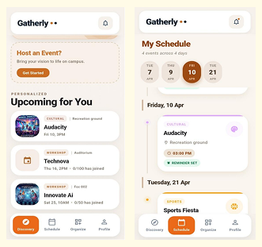
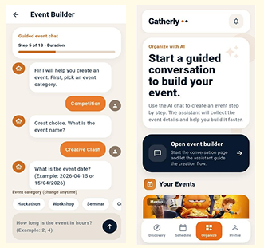
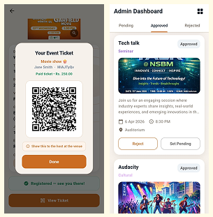
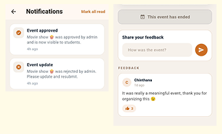
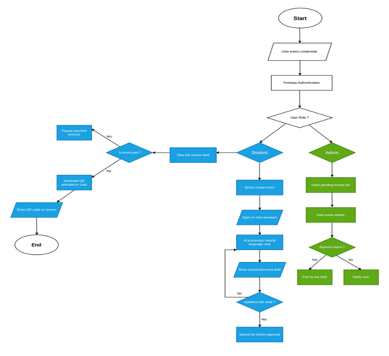

# <p align="center"></p>

<h1 align="center">Gatherly</h1>

<p align="center">
  <strong>The Intelligent Campus Event Discovery & Management Ecosystem</strong>
</p>

<p align="center">
  <a href="#about">About</a> •
  <a href="#ui-showcase">UI Showcase</a> •
  <a href="#how-it-works">How It Works</a> •
  <a href="#features">Features</a> •
  <a href="#tech-stack">Tech Stack</a> •
  <a href="#architecture">Architecture</a> •
  <a href="#getting-started">Getting Started</a> •
  <a href="#configuration">Configuration</a> •
  <a href="#design-system">Design System</a> •
  <a href="#license">License</a>
</p>

<p align="center">
  
  
  
  
  
</p>

---

<a id="about"></a>
## 📌 About Gatherly

**Gatherly** is a next-generation mobile platform built to transform how university students, student societies, event organizers, and campus administrators connect and manage events.

### The Problem It Solves
Campus life is bustling with hackathons, workshops, cultural festivals, guest lectures, and sports meets. However:
* **Information is fragmented**: Announcements are scattered across posters, chat groups, and bulletin boards.
* **Creating events is tedious**: Organizers struggle with rigid, confusing forms and manual capacity tracking.
* **Entry management is slow**: Paper tickets and manual check-ins cause venue bottlenecks.
* **Campus safety and moderation**: Administrations lack an oversight pipeline to review and verify student events.

### The Gatherly Solution
Gatherly unifies the entire campus event lifecycle into one seamless, AI-native Flutter application:
1. **Students** get an AI-curated discovery feed, personal timeline schedules, one-tap reminders, and dynamic paperless QR tickets.
2. **Organizers** build complete events effortlessly via a conversational **Google Gemini 1.5 Flash** assistant, accept registrations/payments, and scan attendee tickets with an in-app camera scanner.
3. **University Admins** oversee campus safety through a structured approval pipeline, club directory, and role-based permissions.

---

<a id="ui-showcase"></a>
## 📱 Visual Tour & UI Showcase

Explore the core user experiences of Gatherly below:

<table align="center" width="100%">
  <tr>
    <td align="center" width="50%" valign="top">
      <h3>01. Discovery & Smart Schedule Hub</h3>
      
      <p align="left">
        • <b>Personalized Feed:</b> AI-recommended campus events tailored to student interests with real-time attendee counters.<br/>
        • <b>Interactive Timeline:</b> Day-by-day calendar schedule featuring venue locations and one-tap device reminders.
      </p>
    </td>
    <td align="center" width="50%" valign="top">
      <h3>02. Conversational AI Event Builder</h3>
      
      <p align="left">
        • <b>Guided 13-Step AI Chat:</b> Conversational setup powered by Google Gemini 1.5 Flash to parse category, duration, venue, and limits.<br/>
        • <b>Organizer Console:</b> Dedicated host workspace for student clubs to manage active listings, rosters, and event drafts.
      </p>
    </td>
  </tr>
  <tr>
    <td align="center" width="50%" valign="top">
      <h3>03. Digital QR Passes & Admin Portal</h3>
      
      <p align="left">
        • <b>Dynamic QR Ticketing:</b> Instant digital entry passes stored in attendee profiles for rapid paperless check-in.<br/>
        • <b>Moderation Pipeline:</b> Multi-state administrative review (<i>Pending, Approved, Rejected</i>) to ensure campus event guidelines.
      </p>
    </td>
    <td align="center" width="50%" valign="top">
      <h3>04. Live Alerts & Community Feedback</h3>
      
      <p align="left">
        • <b>Real-Time Notifications:</b> Instant alerts on administrative approvals, update requests, and event status changes.<br/>
        • <b>Post-Event Engagement:</b> Interactive feedback threads enabling attendees to rate sessions, post reviews, and share reactions.
      </p>
    </td>
  </tr>
</table>

---

<a id="how-it-works"></a>
## 🔄 How Gatherly Works

The system architecture and user journeys are mapped out below, illustrating the end-to-end paths for students, organizers, and administrators:

<p align="center">
  
</p>

### 📌 Architecture & Logic Breakdown

#### 1. Authentication & Role Routing
* **Credential Entry**: Users sign in securely via **Firebase Authentication** (Email or Google Sign-In).
* **Role Decision (`User Role ?`)**: Automatically routes users to their respective portal:
  * 🎓 **Student / Organizer Portal**
  * 🏛️ **University Administrator Portal**

---

#### 2. Student & Organizer Pathways

##### 🎟️ Path A: Event Discovery & Digital Pass Generation
1. **Browse Live Feed**: Students explore upcoming campus events filtered by interest.
2. **Fee Check (`Is event paid ?`)**:
   * **Yes**: Redirects to the **PayPal payment gateway** to complete checkout.
   * **No**: Skips straight to immediate registration.
3. **Dynamic QR Generation**: An encrypted dynamic QR pass is generated and displayed on screen, saved to the student profile for gate entry.

##### 🤖 Path B: AI-Assisted Event Creation
1. **Select "Create Event"**: Launches the conversational event builder.
2. **Google Gemini Conversational AI**: Organizers describe their event naturally; Gemini 1.5 Flash extracts dates, venues, categories, ticket pricing, and limits into a structured draft.
3. **Review & Refine (`Satisfied with draft ?`)**:
   * **No**: Organizers continue chatting with the assistant to fine-tune details.
   * **Yes**: Submits the final draft directly to the university moderation queue.

---

#### 3. University Administration Pathway
1. **Pending Queue**: Admins open the centralized pending events list.
2. **Inspect Event Details**: Verify venue, capacity, guidelines, and organizer identity.
3. **Approval Decision (`Approve event ?`)**:
   * **Yes**: Instantly **published to the live campus feed** for all students to discover.
   * **No**: Rejection or modification feedback is sent via push notification to the host.

---

<a id="features"></a>
## 🌟 Key Features

### 🎓 For Students & Attendees
* **Personalized Event Discovery**: Browse campus events filtered by categories (*Hackathons, Workshops, Seminars, Competitions, Cultural, and Sports*).
* **Interactive Day Timeline & Calendar**: View scheduled events on an interactive calendar powered by `table_calendar`, showing exact venue locations and timing.
* **One-Tap Device Reminders**: Schedule local push notifications directly on your phone using `flutter_local_notifications` before the event begins.
* **Paperless Digital QR Passes**: Dynamic, unique QR codes (`qr_flutter`) generated immediately upon RSVP or ticket purchase, stored securely in the student wallet.
* **Integrated PayPal Payments**: Clean, in-app PayPal checkout gateway (`flutter_paypal`) for paid workshops and ticketed campus events.
* **Interactive Q&A & Feedback**: Ask questions directly to hosts before events, and participate in community discussions and reviews once events wrap up.

### 🚀 For Event Organizers & Campus Clubs
* **Conversational AI Event Builder**:
  * Step-by-step 13-stage conversational workflow powered by `gemini-1.5-flash`.
  * Conversational extraction: simply tell the AI your event details, and it extracts title, category, date, duration, venue, participant limits, and tags.
* **High-Speed Camera QR Scanner**: Fast gate entry validation using `mobile_scanner` to verify attendee tickets at the venue door in real time.
* **Flyer & Poster Uploads**: Custom event imagery uploaded and served via Firebase Storage.
* **Capacity Management**: Live attendee counters prevent overbooking beyond venue safety capacity limits.
* **Co-Hosting Support**: Invite and collaborate with verified co-hosts to run events together.

### 🏛️ For University Administration
* **Moderation Pipeline**: Multi-state approval system (*Pending*, *Approved*, *Rejected*) ensuring all campus activities meet university safety guidelines.
* **Club & Society Directory**: Manage student organizations, assign presidents/representatives, and handle club registrations.
* **Role Elevation**: Easily elevate trusted student organizers to administrative privileges.
* **Student View Preview**: Inspect student-facing interfaces directly from the admin dashboard to review the attendee experience.

---

<a id="tech-stack"></a>
## 🛠️ Tech Stack

| Component | Technology | Role & Purpose |
| :--- | :--- | :--- |
| **Framework** | [Flutter](https://flutter.dev) (v3.x / Material 3) | Cross-platform UI toolkit providing high-performance 60fps native feel |
| **Language** | [Dart](https://dart.dev) (v3.0+) | Strongly typed, null-safe foundation for application logic |
| **Authentication** | [Firebase Auth](https://firebase.google.com/docs/auth) | Secure email/password and Google Sign-In user authentication |
| **Cloud Database** | [Cloud Firestore](https://firebase.google.com/docs/firestore) | Real-time, reactive database for events, tickets, RSVPs, and Q&A |
| **File Storage** | [Firebase Storage](https://firebase.google.com/docs/storage) | Cloud storage for high-resolution event flyers and club banners |
| **Artificial Intelligence** | [Google Gemini 1.5 Flash](https://ai.google.dev/) | Natural language conversational AI event creation assistant |
| **Payment Gateway** | [PayPal SDK](https://developer.paypal.com) (`flutter_paypal`) | Seamless in-app payments for paid events and workshops |
| **Notifications** | [`flutter_local_notifications`](https://pub.dev/packages/flutter_local_notifications) | Local on-device alerts for upcoming event reminders |
| **QR Engine** | [`qr_flutter`](https://pub.dev/packages/qr_flutter) & [`mobile_scanner`](https://pub.dev/packages/mobile_scanner) | Dynamic QR ticket rendering and high-performance camera scanning |
| **Calendar Engine** | [`table_calendar`](https://pub.dev/packages/table_calendar) | Multi-format interactive calendar view for scheduling |
| **Design & Icons** | [`iconsax`](https://pub.dev/packages/iconsax) & `cupertino_icons` | Modern typography, curved cards, and expressive iconography |

---

<a id="architecture"></a>
## 📂 Architecture & Directory Structure

```plaintext
lib/
├── main.dart                          # App entry point, .env loader & auth router
├── models/
│   ├── app_notification_model.dart    # User alerts & notification data schema
│   ├── event_model.dart               # Core event schema (metadata, status, timing, fees)
│   └── user_model.dart                # Role-based user profile (Student / Admin)
├── screens/
│   ├── admin/
│   │   ├── admin_dashboard_screen.dart# Event approval queues, metrics & admin controls
│   │   └── club_screen.dart           # Club registry & society management
│   ├── auth/
│   │   ├── admin_login_screen.dart    # Protected admin sign-in portal
│   │   ├── auth_forms.dart            # Reusable registration & login components
│   │   ├── auth_shell_screen.dart     # Authentication container & tab switcher
│   │   └── google_profile_completion_screen.dart # Student onboarding flow
│   ├── student/
│   │   ├── qr_generator_page.dart     # Attendee digital ticket QR generator
│   │   ├── qr_scanner_page.dart       # Host door check-in camera scanner
│   │   ├── student_dashboard_screen.dart # Main student navigation hub
│   │   ├── student_discovery_page.dart# Event discovery, filtering & detail sheets
│   │   ├── student_event_builder_screen.dart # Conversational Gemini AI builder
│   │   ├── student_notifications_screen.dart # In-app notification inbox
│   │   ├── student_organize_page.dart # Host console, event management & editing
│   │   ├── student_preferences_screen.dart # Category & interest selection
│   │   ├── student_profile_page.dart  # User info, ticket wallet & event history
│   │   ├── student_qna_screen.dart    # Interactive event Q&A board & feedback
│   │   └── student_schedule_page.dart # Timeline & calendar schedule planner
│   └── payments_screen.dart           # PayPal checkout payment bridge
├── services/
│   ├── auth_service.dart              # Firebase Auth & Google Sign-In handler
│   ├── event_service.dart             # Firestore CRUD, RSVP & approval pipelines
│   ├── gemini_event_assistant_service.dart # Natural language event field extraction
│   ├── notification_service.dart      # Local & Firestore reactive notifications
│   └── paypal_checkout_service.dart   # PayPal WebView payment processor
└── widgets/
    ├── club_card.dart                 # Club presentation widget
    ├── custom_text_field.dart         # Styled input elements
    ├── event_card.dart                # Discovery feed event card
    ├── organizer_event_card.dart      # Manageable organizer event card
    ├── schedule_event_card.dart       # Timeline schedule card
    └── student_tab_placeholder.dart   # Skeleton and fallback loading states
```

---

<a id="getting-started"></a>
## 🚀 Getting Started

Follow these steps to set up Gatherly on your local machine.

### Prerequisites
* [Flutter SDK](https://docs.flutter.dev/get-started/install) (`>= 3.0.0`)
* [Dart SDK](https://dart.dev/get-dart)
* [Git](https://git-scm.com)
* An Android Emulator, iOS Simulator, or a physical mobile device
* A [Firebase Console](https://firebase.google.com/) project with **Authentication**, **Cloud Firestore**, and **Firebase Storage** enabled
* A [Google AI Studio](https://aistudio.google.com/) account for a Gemini API key

---

### Step-by-Step Installation

#### 1. Clone the Repository
```bash
git clone https://github.com/Paraseww/Event_management_app.git
cd Event_management_app
```

#### 2. Configure Environment Variables
Create a `.env` file in the root directory:
```bash
touch .env
```
Add your configuration keys as described in the [Environment Configuration](#-environment-configuration) section.

#### 3. Attach Firebase Configuration Files
* **For Android**:
  1. Go to your Firebase project settings.
  2. Register your Android app package (e.g., `com.example.event_management_app`).
  3. Download `google-services.json` and place it at:
     ```plaintext
     android/app/google-services.json
     ```
* **For iOS**:
  1. Register your iOS app in Firebase.
  2. Download `GoogleService-Info.plist` and place it at:
     ```plaintext
     ios/Runner/GoogleService-Info.plist
     ```

#### 4. Install Dependencies
```bash
flutter pub get
```

#### 5. Run the Application
Launch the app on your connected device or emulator:
```bash
# Run on an emulator or connected device
flutter run

# Or launch on Google Chrome for web preview
flutter run -d chrome
```

---

<a id="configuration"></a>
## ⚙️ Environment Configuration

Gatherly uses `flutter_dotenv` to securely load API keys at runtime. Create a `.env` file in the root directory and populate it with your credentials:

```env
# ========================================================
# Firebase Configuration (Required)
# ========================================================
FIREBASE_PROJECT_ID=your_firebase_project_id
FIREBASE_API_KEY=AIzaSy...your_api_key
FIREBASE_APP_ID=1:1234567890:android:abcdef...
FIREBASE_MESSAGING_SENDER_ID=your_sender_id
FIREBASE_STORAGE_BUCKET=your_project_id.appspot.com

# ========================================================
# Google Gemini AI (Required for AI Event Builder)
# ========================================================
GEMINI_API_KEY=your_gemini_api_key

# ========================================================
# PayPal Checkout Gateway (Optional for Paid Ticketing)
# ========================================================
PAYPAL_CLIENT_ID=your_paypal_client_id
PAYPAL_SECRET=your_paypal_secret_key
PAYPAL_SANDBOX=true
```

| Key | Required | Purpose |
| :--- | :---: | :--- |
| `FIREBASE_PROJECT_ID` | **Yes** | Connects to your Firebase cloud backend |
| `FIREBASE_API_KEY` | **Yes** | Authenticates Firebase service requests |
| `FIREBASE_APP_ID` | **Yes** | Identifies the client application |
| `FIREBASE_STORAGE_BUCKET`| **Yes** | Storage endpoint for event flyers and club logos |
| `GEMINI_API_KEY` | **Yes** | Powers the conversational 13-stage AI event assistant |
| `PAYPAL_CLIENT_ID` | *Optional* | Client ID for handling paid ticket transactions |
| `PAYPAL_SECRET` | *Optional* | Secret key for the PayPal payment processor |
| `PAYPAL_SANDBOX` | *Optional* | Toggle between sandbox (`true`) and production (`false`) |

> 🔒 **Security Notice:** The `.env` file and Firebase configuration files contain sensitive API credentials. They are included in `.gitignore` and must **never** be committed to public version control.

---

<a id="design-system"></a>
## 🎨 Design System

Gatherly is styled with a warm, human-centric aesthetic designed to feel welcoming, energetic, and intuitive:

* **Deep Navy (`#0D1B2E`)**: Anchor tone for high-contrast, effortless typography and headers.
* **Warm Terracotta (`#CB6D22`)**: Primary action accent used for buttons, active tabs, and primary calls to action.
* **Refined Gold (`#C4A052`)**: Secondary highlight color for badges, ratings, and featured indicators.
* **Soft Cream Surface (`#F6F1EB`)**: Subtle, warm background surface that eliminates harsh screen glare and reduces eye fatigue.
* **Tactile Curves**: 24px rounded corners, smooth modal bottom-sheets, and animated tab bars create a friendly, native mobile touch experience.

---

<a id="license"></a>
## 📄 License

This project is licensed under the [MIT License](LICENSE) — see the LICENSE file for details.

